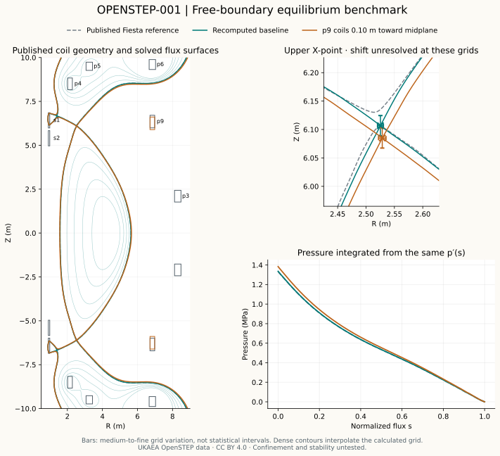

# OPENSTEP-001: a published equilibrium reproduced

**Result: numerical benchmark PASS. Physical confinement and stability were not tested.**

On 20 November 2026, a free-boundary Grad–Shafranov calculation reproduced the published UKAEA OpenSTEP EB-CC design equilibrium using its explicit fourteen coil packs, seven circuit currents, and native pressure/current profile derivatives. It then re-solved the equilibrium with both p9 coil packs translated 0.10 m toward the midplane. All circuit currents and profile functions stayed fixed.



## Reproduction checks

| Quantity | Measured | Preset limit | Finding |
|---|---:|---:|---|
| Gauge-aligned core flux RMSE | 0.1542% | 1% | PASS |
| Magnetic-axis position error | 0.0613 cm | 5 cm | PASS |
| Largest primary X-point error | 1.2126 cm | 10 cm | PASS |
| Total current error | 0.0613% | 1% | PASS |

The 129×257 and 257×513 baseline and modified runs converged, with full-domain normalized nonlinear defects below 1e-5. Both arms passed the specified axis, X-point and current refinement limits. The 65×129 runs did **not** converge and are retained as UNRESOLVED coarse-grid attempts; this is not a claim of convergence on every mesh.

## Controlled change

| Observable | Baseline, fine grid | Modified, fine grid | Difference | Resolution finding |
|---|---:|---:|---:|---|
| Plasma current | 22.77441 MA | 23.01689 MA | +0.24248 MA | Larger than observed grid variation |
| Enclosed core volume | 710.46856 m³ | 713.01319 m³ | +2.54463 m³ | Larger than observed grid variation |
| Core cross-section | 33.75046 m² | 33.84514 m² | +0.09468 m² | Larger than observed grid variation |
| On-axis pressure | 1.33527 MPa | 1.38385 MPa | +0.04858 MPa | Larger than observed grid variation |
| Integrated pressure ∫p dV | 400.86746 MJ | 414.12983 MJ | +13.26237 MJ | Larger than observed grid variation |

The magnetic axis moves outward **1.600 cm**; the sum of the two arms’ medium-to-fine axis shifts is 0.140 cm. The outboard midplane radius grows by 3.198 cm, and the inboard radius decreases by 1.643 cm.

The upper X-point moves -2.172 cm vertically in the computed fields, but the combined observed refinement variation is 3.552 cm. Both radial and vertical X-point movement are therefore **UNRESOLVED** under the conservative effect-versus-refinement rule. These variations are numerical diagnostics, not statistical confidence intervals or rigorous error bounds.

The higher current and pressure are outputs of this particular fixed-p′/FF′ comparison. They do not establish better confinement, extra energy generation, an achievable operating point under a current-drive system, or improved stability. The pressure integral is ∫p dV, not a fusion-power calculation. Absolute pressure uses the stated p(edge)=0 boundary condition.

## Provenance and numerical changes

The original reference is a UKAEA design simulation, not an experimental discharge. OpenSTEP’s NetCDF file declares IMAS Data Dictionary 4.0.0 / COCOS 17, while its README describes DD3 / COCOS 11. The native MAT data and explicit numerical identities fix the sign and 2π conversion. Source hashes, explicit coil inputs, and unit conventions are included.

Hard grid-point cutoffs and Picard iteration were unsuccessful. The scored solver uses accurate critical points, a cell-area treatment of the separatrix, and a Newton–Krylov root solve with up-down symmetry. A wrapper array-mutation bug was corrected before the scored runs. These were adaptive numerical changes; thresholds were not changed. See [METHODS.md](METHODS.md), [PROTOCOL.md](PROTOCOL.md), and the [development record](development/attempt-index.json).

## Replay

Python 3.12.14 was used. From the repository root:

```sh
python -m venv .venv-equilibrium
source .venv-equilibrium/bin/activate
python -m pip install -r benchmarks/openstep-001/requirements.txt
python benchmarks/openstep-001/fetch_sources.py
python benchmarks/openstep-001/benchmark.py --n 129 --method newton --edge cell --tag=-symmetric --maxits 40
python benchmarks/openstep-001/benchmark.py --n 257 --method newton --edge cell --tag=-symmetric --maxits 40
python benchmarks/openstep-001/benchmark.py --n 129 --method newton --edge cell --tag=-symmetric --shift 0.1 --maxits 40
python benchmarks/openstep-001/benchmark.py --n 257 --method newton --edge cell --tag=-symmetric --shift 0.1 --maxits 40
python benchmarks/openstep-001/assess.py
python benchmarks/openstep-001/verify.py
```

For the deliberately retained coarse-grid diagnostics, repeat each arm at `--n 65`; inspect `converged` and `final_defect`, not just the process exit code. The four scored runs, two coarse attempts, full field arrays, iteration logs, [summary](results/summary.json), [verification](results/verification.json), and upstream inputs are distributed. No stochastic seed is used.

## What this advances

The repository now includes a reproducible, dimensioned free-boundary equilibrium benchmark with a controlled coil change. The earlier TriSphere radial and inventory simulators remain separate illustrative models. Thirteen/five layer counts were not used as magnetic laws.

Further work should first resolve the X-point displacement on finer grids and repeat the comparison under an explicit total-current/pressure operating constraint. MHD stability, vertical control, transport, divertor loading, coil feasibility and net power still require separate models and evidence.

## Attribution

Brown, Theodore; Casson, Francis; Hudoba, Agnieszka; Marsden, Stephen; Tholerus, Emmi; Wilson, Thomas; and the STEP Team (2025). *OpenSTEP: public data release of the STEP Prototype Powerplant scenario SPP-001*. UKAEA. [DOI 10.14468/07jt-s540](https://doi.org/10.14468/07jt-s540). Source commit `6f66ae09c60b361d600b178416ef3f22b8d0aa6a`. The unmodified source files and adapted figures/data retain [CC BY 4.0](source/LICENSE-OpenSTEP.txt); see [source citation](source/CITATION-OpenSTEP.cff). Analysis and wrappers are new work; no UKAEA endorsement is implied. FreeGS 0.8.2 is an unmodified LGPL-3.0-or-later dependency.
