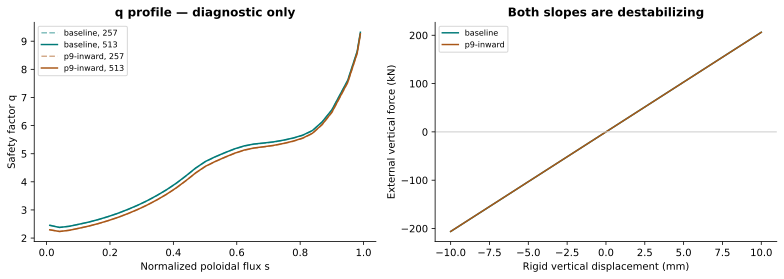
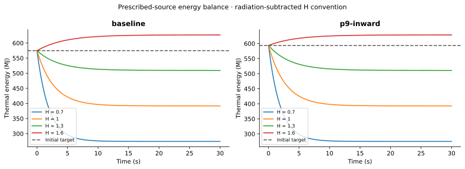
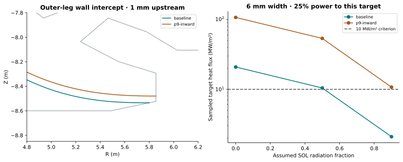
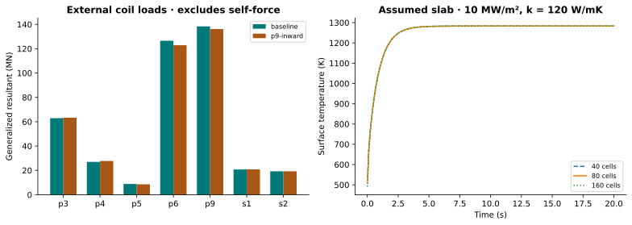

# OPENSTEP-002 — extended simulation screens

20 November 2026 · Matthew Chenoweth Wright / Monolithic LLC

**The translated-coil configuration is not demonstrated to be a better tokamak
design.** The executed screens reveal destabilizing no-wall vertical response,
conditional heat-load exceedances and strong dependence on the operating
constraints. They do not establish physical feasibility. The source STEP design
is itself a published design simulation; these are not measurements or a critique
of the complete STEP engineering programme.

[Open the interactive results](https://enuminous.github.io/Tokamak/screening.html)
· [Machine-readable summary](results/summary.json)
· [Frozen protocol](PROTOCOL.md)
· [Methods](METHODS.md)
· [Development/failures](DEVELOPMENT.md)

## Results

The selected equilibrium grid is **513 × 1025**, compared with 257 × 513.
The reproduced baseline's gauge-aligned core-flux RMSE against the pinned Fiesta
reference is **0.0878%** of its axis-to-boundary flux span.
The original experiment keeps the seven coil circuit currents and the derivative
profiles p′(s), FF′(s) fixed while moving both p9 packs 10 cm toward the midplane.
The controlled experiment instead fixes baseline pressure p(s) and total plasma
current. These are different physical constraints.

| Category | Executed calculation | Finding and limit |
|---|---|---|
| Numerical | Refined free-boundary equilibrium and independent residual | See per-run convergence and observed grid differences below. |
| Stability | q/beta profiles; ±1, ±5, ±10 mm rigid vertical translations | Both arms have positive dFz/dz, about 20.62 MN/m. This tests a rigid fixed-current/no-wall model, not MHD eigenmodes. |
| Confinement | 72 prescribed-source 30 s energy ODE cases | Required radiation-subtracted H changes 1.467 → 1.511 at the mapped energy targets. H is assumed, not observed. |
| Exhaust | 20 field-line traces; 240 heat samples | 119 chosen samples exceed the 10 MW/m² steady target criterion. No detachment or neutral recycling model. |
| Engineering | Pack geometry, external magnetic loads, required support-area sensitivity | Largest generalized load 138.3 MN. Self-force, actual winding/support design and allowable stress are missing. |
| Thermal | 36 one-dimensional diffusion cases plus refinement | Central assumed slab reaches 1283.3 K at 20 s. This is not a material/cooling qualification. |
| Electric budget | 80 efficiency/parasitic combinations | -128.9 to 522.0 MW conditional net electricity. Fusion power is prescribed. |

Sweep counts and positive/negative counts are properties of the selected grid of
assumptions, **not probabilities** or performance forecasts.

### Equilibrium and operating-point control

| Arm | Grid | Outcome | Independent normalized defect |
|---|---|---|---|
| baseline | 129 × 257 | CONVERGED | 8.26e-08 |
| baseline | 257 × 513 | CONVERGED | 4.39e-08 |
| baseline | 513 × 1025 | CONVERGED | 6.95e-07 |
| p9-inward | 129 × 257 | CONVERGED | 3.01e-06 |
| p9-inward | 257 × 513 | CONVERGED | 6.96e-09 |
| p9-inward | 513 × 1025 | CONVERGED | 2.55e-07 |

| Quantity (SI units) | Baseline | p9 inward | Change | Sum of last grid changes | Effect screen |
|---|---|---|---|---|---|
| axis_R_m | 4.389302 | 4.405209 | +0.015906 | 0.000796 | RESOLVED |
| upper_X_R_m | 2.523437 | 2.526702 | +0.0032647 | 0.00392 | UNRESOLVED |
| upper_X_Z_m | 6.111075 | 6.091728 | -0.019348 | 0.0112 | RESOLVED |
| Ip_A | 2.276545e+07 | 2.300928e+07 | +2.4383e+05 | 1.66e+04 | RESOLVED |
| pressure_axis_Pa | 1333912 | 1382107 | +48195 | 3.1e+03 | RESOLVED |
| volume_m3 | 709.8768 | 712.8853 | +3.0085 | 0.72 | RESOLVED |

Observed grid variation is a heuristic numerical screen, not an error bound or
confidence interval. No Richardson order is inferred from discontinuous core
masking. Historical OPENSTEP-001 results are preserved unchanged.

At fixed p(s) and total Ip, the 257-grid axis change is -8.935 cm. This is a separate operating constraint, not the fixed-p′ experiment. Check the medium-grid statuses below before treating it as a refinement-verified effect.

| Fixed-p(s)/Ip arm | Grid | Outcome | Independent normalized defect |
|---|---|---|---|
| baseline | 129 × 257 | UNRESOLVED | 0.00126 |
| baseline | 257 × 513 | CONVERGED | 9.53e-12 |
| p9-inward | 129 × 257 | CONVERGED | 3.5e-06 |
| p9-inward | 257 × 513 | CONVERGED | 1.94e-06 |

All converged constrained runs meet the target Ip and on-axis pressure to the
recorded floating-point tolerances. A failed solve is not evidence that the
physical equilibrium cannot exist. Failed/interrupted attempts remain in
`development/`; accepted fields and final residuals are in `results/`.

### Magnetic diagnostics

| Arm | Minimum sampled q | q95 | Toroidal beta | Normalized beta |
|---|---|---|---|---|
| baseline | 2.3783 | 7.6092 | 13.869% | 3.9373 |
| p9-inward | 2.2341 | 7.5389 | 14.328% | 4.0631 |

The sample runs from s = 0.01 to 0.99; it is not a proof of a global q minimum.
No universal beta threshold is used to declare stability. The two vertical-force
gradients are close; a small difference must be compared with grid variation.
The change is -8.16 kN/m,
against 24.28
kN/m summed last-grid variation (UNRESOLVED by the stated screen).
The force calculation includes no wall eddy currents, controller or plasma
current/shape response, and supplies **no physical instability growth rate**.



### Power balance and confinement conventions

The pinned JETTO source gives 574.691 MJ thermal energy,
1.7345 × 10²⁰ m⁻³ line-average electron density,
129.000 MW auxiliary, 311.249 MW alpha,
1.314 MW ohmic, and 298.514 MW core
radiation. Their sum gives 143.049 MW transported power;
the source-power balance closes exactly at the recorded precision. Integrating
its thermal profile differs from its summary energy by
0.173%, which is retained.

The baseline uses the JETTO thermal energy as a mapped target. The modified target
scales with the equilibrium pressure integral, retaining the same thermal
fraction, density, composition and prescribed powers. This is an assumption;
kinetic transport was not recomputed in the changed geometry.

With radiation-subtracted power, required H is
1.467 → 1.511.
With total heating treated as the loss power in both τ = W/P and the scaling,
the corresponding values are 1.034 →
1.065. These conventions must not be mixed. The
source's stored H98 = 1.451 uses its own summary/geometry.
The apparent higher stored energy from fixed p′ does not demonstrate better
confinement.



### Exhaust and materials

For a 6 mm upstream exponential width, a 1 mm upstream offset and 25% of the
separatrix power allocated to one target, the sampled attached target flux is
20.88 → 107.31 MW/m² without SOL radiation.
With 90% SOL radiation it is 2.09 →
10.73 MW/m². These are samples, not guaranteed peaks.
The target segment and incidence angle can change under refinement; inspect
the per-grid trace CSVs. Upstream offsets can be smaller than the equilibrium
mesh spacing: interpolation is not additional physical resolution.



The supplied wall/domes are unchanged when the coils move. Approximate
s = 0.999 surface-to-wall distances are 8.93 cm
and 7.33 cm. The pack-intersection check uses
rectangular filament-pack bounds and finds
0 positive-area pack overlaps;
this says nothing about absent supports, casings or access paths.

The coil force calculation excludes self-force. The radial value is integrated
outward/hoop loading around the ring, not a net Cartesian force. Dividing its
generalized resultant by 100, 300 or 600 MPa gives illustrative required areas,
not structural stresses from FEA. Likewise equivalent ampere-turn density is not
superconductor current density without winding turns and fill factor.

The slab fixes its back face at 450 K, volumetric heat capacity at 2.5 MJ/(m³ K),
and sweeps k = 80/120/180 W/(m K), L = 5/10/20 mm, q = 1/5/10/20 MW/m².
Constant-property temperatures can reach 5371 K;
such outputs flag the assumptions' limits, not a surviving component. No
melting, coolant resistance, erosion, fatigue or neutron damage is modelled.



## Explicitly unrun higher-fidelity tests

| Test | Status | Missing model/input |
|---|---|---|
| Wall-coupled vertical eigenmodes and feedback | NOT RUN / UNRESOLVED | Wall outline has no calibrated conducting volumes, resistivity/thickness, circuit and controller model |
| 3-D ideal/resistive/kinetic MHD spectrum | NOT RUN / UNRESOLVED | No validated 3-D MHD model or eigenmode calculation in this suite |
| Predictive turbulent transport and self-consistent burn | NOT RUN / UNRESOLVED | Confinement scaling and prescribed-source ODE are reduced sensitivity models |
| SOL detachment and neutral recycling | NOT RUN / UNRESOLVED | Field-line geometry and imposed heat distribution do not solve SOL fluid/kinetic-neutral equations |
| Full structural, superconducting and cooling qualification | NOT RUN / UNRESOLVED | Support CAD, material allowables/critical surfaces and cooling circuits missing |
| Neutron damage and tritium breeding | NOT RUN / UNRESOLVED | Material composition and 3-D blanket/shield model missing |

TokaMaker native initialization succeeded, but **no TokaMaker eigenmode result**
is presented. A wall outline alone does not define the conducting structures.
The reported neutron wall load is a uniform geometric average only. The net
electric sweep assumes complete heat recovery and unity blanket multiplication;
neither establishes tritium self-sufficiency or a power-producing plant.

## Replay

Python 3.12.14 was used. Run from this directory after installing the pinned
requirements into your chosen virtual environment:

```bash
python -m pip install -r requirements.txt
python fetch_sources.py
python boundary_check.py
python critical_check.py
python refine.py --n 513 --shift 0
python refine.py --n 513 --shift .1
python controlled.py --n 129 --shift .1
python controlled.py --n 257 --shift 0
python controlled.py --n 257 --shift .1 --warm-grid 129 --warm-controlled
python controlled.py --n 129 --shift 0 --warm-grid 129
python screens.py --n 129 --part all
python screens.py --n 257 --part all
python screens.py --n 513 --part all
python thermal.py
python diagnostic_checks.py
python verify.py
python assess.py
python write_report.py
```

Set `OPENBLAS_NUM_THREADS=1` for the recorded thread setting. Prerequisite 001
fields are committed; see its own replay for generating them. `Field` refuses
nonconverged inputs. If a refined solve fails, do not run screens on that field;
the report falls back to the finest mutually converged screened pair.
The cached boundary operator has an independent algebraic-equivalence test
against unmodified FreeGS, and keeps the original numerical boundary convention.
Iterative critical-point searches omit coil-pack regions; the accepted final
diagnostics and residual use the original full-domain search. The restricted
search has a separate source-equivalence test on both earlier grids and arms.

Verification currently records **66 PASS, 0 FAIL** for
implementation/conservation/numerical checks. These are separate from physical
feasibility. [Detailed checks](results/verification.json) and the artifact hash
manifest allow a reviewer to distinguish source data, computed fields, selected
assumptions and unsupported claims.

## Sources and licensing

- Brown et al., [OpenSTEP](https://github.com/ukaea/OpenSTEP/tree/6f66ae09c60b361d600b178416ef3f22b8d0aa6a), [DOI 10.14468/07jt-s540](https://doi.org/10.14468/07jt-s540), CC BY 4.0. The pin represents STEP SPP-001/CML5/SPR45, not a claim about the latest STEP design. See [source manifest](source/manifest.json), and the license/citation in `../openstep-001/source/`.
- UKAEA PROCESS, [confinement definitions and IPB98(y,2)](https://ukaea.github.io/PROCESS/physics-models/plasma_confinement/) and [IPB elongation definition](https://ukaea.github.io/PROCESS/source/reference/process/models/physics/plasma_geometry/). Our implementation evaluates the published formula; this is not a PROCESS plant-model run.
- Henderson et al., [Nuclear Fusion 65 (2025) 016033](https://doi.org/10.1088/1741-4326/ad93e7), for the 10 MW/m² steady target criterion and heat-width sensitivity range. Our geometric attached-footprint model is not their detached SOL model or its equation (22).
- Tholerus et al., [flat-top operational space](https://arxiv.org/abs/2403.09460), contextual source for the distinct integrated JETTO operating point.
- [Open FUSION Toolkit vertical-stability example](https://openfusiontoolkit.github.io/OpenFUSIONToolkit/docs/v26.9/doc_tMaker_DIIID_ex2.html), for required wall/circuit modelling; not executed as a STEP validation.
- FreeGS 0.8.2: LGPL-3.0-or-later. `cached_boundary.py` is adapted from its boundary implementation; [license](LICENSE-FreeGS.txt). Other dependencies retain their own licenses. Data-derived figures are adaptations, with no UKAEA endorsement implied.
