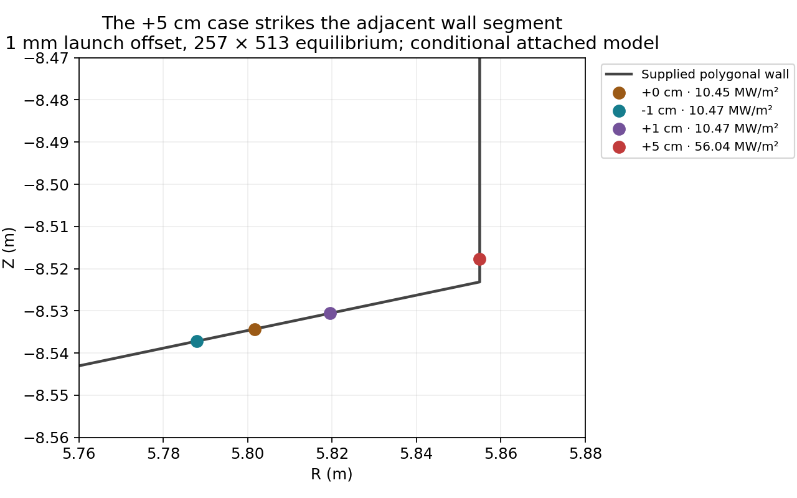
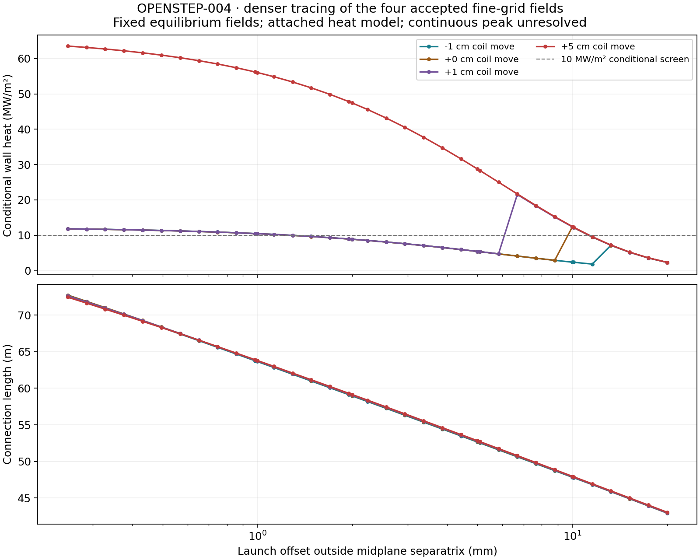

# OPENSTEP-004 — the next numerical validation checks

Matthew Chenoweth Wright / Monolithic LLC · 21 November 2026

**Execution: completed. Numerical assertions: 792 PASS, 220 FAIL. Physical qualification: UNRESOLVED.**

These assertions include file-integrity checks and repeated per-trace acceptance conditions; they are not independent physical experiments. The substantive comparisons are eight uncached equilibrium replays, eight direct-coil force calculations and forty comparisons of the old and new tracing methods.

The historical OPENSTEP-003 conclusion is preserved: no tested coil movement has demonstrated an improvement that survives the specified equilibrium-grid comparison. This suite does not make a new geometry winner or run full MHD.

## Results by check family

| Check family | PASS | FAIL |
|---|---:|---:|
| preflight | 164 | 0 |
| controls | 11 | 0 |
| equilibria | 33 | 0 |
| tracing | 577 | 219 |
| sampling | 3 | 1 |
| provenance | 4 | 0 |

## Equilibrium and force replay

| Grid | Move (cm) | Uncached normalized defect | Direct stiffness (MN/m) | Difference from prior force |
|---|---:|---:|---:|---:|
| 129 × 257 | +0 | 4.34e-08 | 20.70979 | 0.01117% |
| 129 × 257 | -5 | 4.41e-10 | 20.44665 | 0.01142% |
| 129 × 257 | -1 | 7.02e-11 | 20.58257 | 0.01139% |
| 129 × 257 | +1 | 5.14e-09 | 20.72242 | 0.01119% |
| 257 × 513 | +0 | 1.12e-11 | 20.64261 | 0.00265% |
| 257 × 513 | -1 | 9.22e-10 | 20.57461 | 0.00267% |
| 257 × 513 | +1 | 1.39e-08 | 20.67870 | 0.00265% |
| 257 × 513 | +5 | 1.92e-08 | 20.89059 | 0.00259% |

Positive stiffness means destabilizing in the rigid, fixed-coil, no-wall model. No conducting vessel, controller, plasma deformation or MHD eigenmode is included. The original 1e−5 residual limit was retained. The deliberately perturbed equilibrium must be rejected for its negative control to pass.

## Different tracing route

The new tracer uses adaptive DOP853 in toroidal angle and continuous signed-distance wall events. The previous tracer uses fixed-step RK4 in poloidal arc length and chord/wall intersections. Both share the saved equilibrium, cubic flux interpolant and wall geometry; this is implementation diversity, not an independent physics model or independent reviewer.

Across forty original-offset comparisons, the largest differences were **3.587 µm** in strike position, **0.199 mm** in connection length and **0.00015%** in representative heat.

The suite also checks tighter adaptive tolerances, reverse-direction tracing, analytic uniform-field trajectories and rejection of a deliberately inconsistent flux/field pair. Raw positions, lengths, target segments and solver evaluation counts are retained.

### Why the +5 cm heat projection is much larger



The third-tolerance fine-grid replay places the baseline and both 1 cm cases on wall segment 12, while the +5 cm case hits adjacent segment 13 (zero-based indices in the supplied main-wall polygon). The different surface normal raises the normal field and reduces the flux-tube area expansion. Thus the approximately 56 MW/m² projection is reproduced by the alternative tracer; it is tied to the imposed wall geometry and heat model. This does not establish the heat on a manufactured, rounded target or a detached plasma.

| Fine-grid field | Segment | R target (m) | Z target (m) | Normal field (T) | Area expansion |
|---|---:|---:|---:|---:|---:|
| shift-+000mm-257 | 12 | 5.801614 | -8.534336 | 0.216921 | 6.82565 |
| shift--010mm-257 | 12 | 5.787934 | -8.537200 | 0.217724 | 6.79133 |
| inward-010mm-257 | 12 | 5.819519 | -8.530587 | 0.216420 | 6.83100 |
| inward-050mm-257 | 13 | 5.855000 | -8.517715 | 1.146287 | 1.29026 |

## Denser fine-grid footprints



| Move (cm) | Heat at 1 mm (MW/m²) | 17-point max | 33-point max | All 37 max | All 37 max offset (mm) | At interval endpoint? |
|---|---:|---:|---:|---:|---:|---|
| -1 | 10.46754 | 11.83671 | 11.83671 | 11.83671 | 0.2500 | Yes |
| +0 | 10.45222 | 11.82041 | 12.17719 | 12.35072 | 10.0000 | No |
| +1 | 10.46570 | 21.53509 | 21.53509 | 21.53509 | 6.6874 | No |
| +5 | 56.04329 | 63.51799 | 63.51799 | 63.51799 | 0.2500 | Yes |

The nested grids cover only 0.25–20 mm. Original offsets are additionally retained. Each fine field has 37 distinct sampled offsets; 32 new integrations per field supplement the original five. An endpoint maximum or a narrow unsampled feature prevents treating the sampled maximum as the physical peak, even when 17/33 values agree. Launch offsets smaller than the equilibrium spacing do not add equilibrium resolution.

These are the same conditional assumptions as 003: 6 mm upstream width, 50% SOL radiation, 25% one-target power, prescribed source power and attached flux-tube projection. They do not model detachment, neutrals or heat transport across flux surfaces.

The baseline maximum on the nested geometric grids changes by 3.02% between 17 and 33 points, failing the frozen 1% sampling-consistency check. Including the original five offsets gives its largest recorded sample at 10 mm (12.3507 MW/m²). The +1 cm geometry has an additional high sample near 6.6874 mm (21.5351 MW/m²), where the wall segment changes. These dense values are diagnostics from the standard adaptive settings; their stricter flux failures remain recorded, and they are not certified continuous maxima.

## Failed checks

| Failure family | Failed assertions |
|---|---:|
| 17_33_sampled_maximum | 1 |
| adaptive_tightening | 29 |
| flux | 189 |
| mirror_trace | 1 |

Every individual failure and its value/limit is retained in [verification.json](results/verification.json). The original numerical suite remains FAIL; later refinement does not overwrite those results.

## Bounded third-tolerance diagnosis

After the first failures, all eight fields were retraced at the fixed 1 mm representative offset with rtol 1e-12 and a 0.025 rad maximum step. This separate diagnostic records **32 PASS, 1 FAIL**. See [AMENDMENTS.md](AMENDMENTS.md) and the [full refinement assessment](results/refinement-assessment.json).

| Field | Normalized flux drift | Tight-to-third strike change (µm) | Length change (mm) | Heat change (%) |
|---|---:|---:|---:|---:|
| recovery-homotopy-10 | 3.2e-09 | 0.0781 | 0.0219 | 0.000004 |
| shift--050mm-129 | 3.72e-09 | 0.0030 | 0.0209 | 0.000000 |
| shift--010mm-129 | 2.02e-08 | 0.0333 | 0.0143 | 0.000002 |
| inward-010mm-129 | 8.69e-09 | 0.1719 | 0.0748 | 0.000009 |
| shift-+000mm-257 | 4.11e-09 | 0.1928 | 0.2383 | 0.000010 |
| shift--010mm-257 | 1.24e-08 | 0.1235 | 0.0215 | 0.000006 |
| inward-010mm-257 | 6.74e-09 | 0.0210 | 0.0587 | 0.000001 |
| inward-050mm-257 | 1.07e-08 | 0.0400 | 0.0046 | 0.000001 |

The initial checks and dense samples are retained unchanged. A successful representative-point diagnosis would not certify every dense sample, remove equilibrium-grid dependence, or establish a physical peak.

## What is still unresolved

- The six unaccepted grid/geometry cases from 003 remain unresolved; this suite does not solve them.
- Equilibrium-grid dependence and the continuous heat-load maximum remain unresolved. The +5 cm case still lacks an accepted coarse counterpart.
- Full 3-D MHD and conducting-wall/feedback stability: NOT RUN.
- Predictive turbulent transport and self-consistent burn: NOT RUN.
- SOL detachment and neutral recycling: NOT RUN.
- Structural, superconducting, cooling and neutron qualification: NOT RUN.

## Reproduce

Run from the repository root with Python 3.12. The 001–003 files and their front-page inputs remain unchanged in this publication, so the 003 inventory can be checked directly. Source numerical dependencies are pinned in the inherited requirements.

```sh
python -m pip install -r benchmarks/openstep-004/requirements.txt
OPENBLAS_NUM_THREADS=1 python benchmarks/openstep-004/validate.py preflight
OPENBLAS_NUM_THREADS=1 python benchmarks/openstep-004/validate.py controls
OPENBLAS_NUM_THREADS=1 python benchmarks/openstep-004/validate.py equilibria
OPENBLAS_NUM_THREADS=1 python benchmarks/openstep-004/validate.py tracing
OPENBLAS_NUM_THREADS=1 python benchmarks/openstep-004/refine_traces.py
OPENBLAS_NUM_THREADS=1 python benchmarks/openstep-004/report.py
```

See [PROTOCOL.md](PROTOCOL.md), [summary.json](results/summary.json), [verification.json](results/verification.json) and [artifact-manifest.json](artifact-manifest.json). Each stage records the code/protocol hashes. FAIL assertions are recorded even when a calculation completes normally; inspect the numerical status rather than only the process exit code.

## Sources and independence

- [Historical controlled scan](../openstep-003/README.md), parent `2438abacf652478ec7865b3ce1fce5d17ad8ab1c`.
- [SciPy 1.17.0 solve_ivp](https://docs.scipy.org/doc/scipy-1.17.0/reference/generated/scipy.integrate.solve_ivp.html): DOP853 and event handling.
- [FreeGS 0.8.2 diagnostics](https://freegs.readthedocs.io/en/stable/diagnostics.html): toroidal-angle field-line tracing conventions.
- UKAEA OpenSTEP, Brown et al., [DOI 10.14468/07jt-s540](https://doi.org/10.14468/07jt-s540), pinned source `6f66ae09c60b361d600b178416ef3f22b8d0aa6a`, CC BY 4.0. No UKAEA endorsement implied.
- Original FreeGS boundary and coil routines remain shared LGPL-3.0-or-later dependencies. The profile/connectivity implementation, equilibrium and wall are shared inputs; agreement cannot establish their physical correctness.
