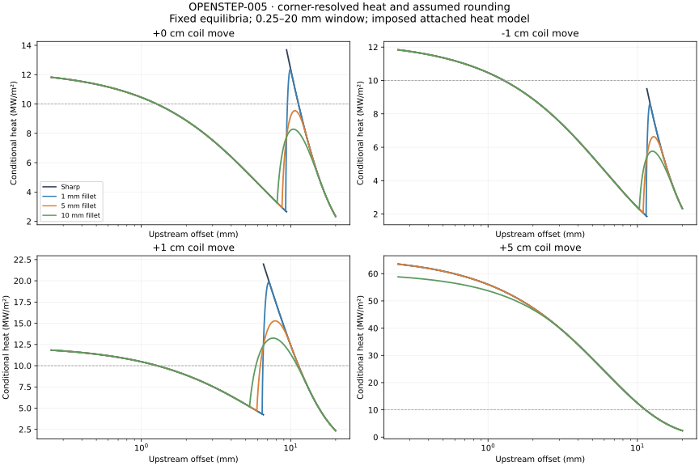
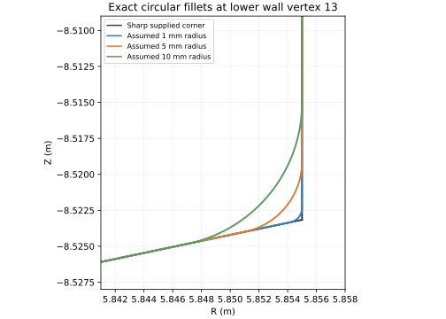
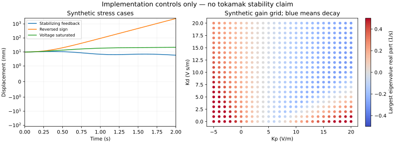

# OPENSTEP-005: contour validation, wall corners and synthetic feedback

**Execution complete. Numerical checks: 2064 PASS, 0 FAIL.**
These are assertions, not independent experiments. Device wall stability and
physical design validation remain **UNRESOLVED**.

Parent: [`4939a9314d2db8482a4a0f7421ca4bb1d125917d`](https://github.com/enuminous/Tokamak/commit/4939a9314d2db8482a4a0f7421ca4bb1d125917d).
The frozen [protocol](PROTOCOL.md), [inputs](inputs.json),
[verification ledger](results/verification.json) and [development record](DEVELOPMENT.md)
separate this calculation from historical results. OPENSTEP-004's
792 PASS/220 FAIL initial assertions and
32 PASS/1 FAIL
bounded refinement remain unchanged.

## What changed

The new tracer follows the implicit contour `psi(R,Z) = psi_launch` and integrates
connection length separately. All eight accepted equilibria are reused without
retuning. The heat study resolves the sharp-wall transition and evaluates three
explicitly assumed corner radii. A separate synthetic implementation exercises
wall-current dynamics and feedback; it does not compute STEP eigenmodes.

| Stage | PASS | FAIL |
|---|---:|---:|
| preflight | 201 | 0 |
| controls | 49 | 0 |
| contours | 520 | 0 |
| derivative-cache | 40 | 0 |
| footprints | 1184 | 0 |
| wall-feedback | 28 | 0 |
| provenance | 42 | 0 |

## Contour and length results

- 88 physical-field trace records: 40 offsets at each of two settings,
  plus eight reverse 1 mm traces. Nine analytic traces include one inconsistent
  field used as a negative control.
- Maximum normalized flux error: **2e-13**.
- Maximum 20/10 mm chart-step and 8/16-node quadrature refinement changes:
  **5.11e-13 m** strike,
  **2.25e-11 m** connection length,
  **2.81e-13** relative heat.
- Across all eight 1 mm comparisons, maximum difference from OPENSTEP-004's
  third-tolerance DOP853 route is **1.61e-05 m**
  in length, within the frozen 0.1 mm limit.

Both routes share the same flux arrays, bicubic interpolation and imposed
toroidal field. Their agreement verifies this numerical calculation; it is not
independent validation of the equilibrium or plasma physics. Flux error alone
is not sufficient evidence because projection enforces the flux constraint.
Analytic length controls, quadrature refinement, mirror tests and the alternate
DOP853 comparison provide the additional checks.

Raw records: [traces](results/contour-traces.csv),
[comparisons](results/contour-comparison.csv),
[paths](results/contour-paths.npz) (columns R, Z, accumulated length, in metres).

## Heat footprint and rounded-corner sensitivity

All values below are **conditional MW/m²** over the upstream offset window
**0.25–20 mm**, with the same imposed 6 mm exponential width, 50% SOL radiation
and 25% one-target power fraction. Source power comes from the separately
identified JETTO flat-top source, as in OPENSTEP-002/003/004; it is not a newly
self-consistent power/transport solution for each equilibrium.

| Coil move | Old 37-point sharp sample | Resolved sharp limit | 1 mm fillet | 5 mm fillet | 10 mm fillet |
|---|---:|---:|---:|---:|---:|
| +0 cm | 12.3507 | 13.6930 | 12.3690 | 11.8204 | 11.8204 |
| -1 cm | 11.8367 | 11.8367 | 11.8367 | 11.8367 | 11.8367 |
| +1 cm | 21.5351 | 21.9709 | 19.8338 | 15.2811 | 13.2477 |
| +5 cm | 63.5180 | 63.5180 | 63.5180 | 63.5180 | 58.8269 |

The baseline sharp-wall maximum is **13.6930 MW/m²** at
**9.380951 mm**, a one-sided limit on face 13. At the exact
polygon vertex the normal is undefined; a single heat value there would be
misleading. The two limits are:

| Coil move | Corner launch offset (mm) | Face 12 limit (MW/m²) | Face 13 limit (MW/m²) |
|---|---:|---:|---:|
| +0 cm | 9.380951 | 2.6555 | 13.6930 |
| -1 cm | 11.570150 | 1.8602 | 9.5062 |
| +1 cm | 6.567228 | 4.2177 | 21.9709 |

The +5 cm case does not cross that sharp corner inside the selected window.
Endpoint maxima remain endpoint-limited; nothing here bounds the heat closer
to the separatrix than 0.25 mm. Nested 65/129/257-point sampling on each target
interval and bounded local searches agree at the frozen 1% criterion where
their assertions pass. This is a converged numerical search, not an interval
proof of a global maximum.

There are 9766 direct flux-map samples across 16 scenarios and
146 additional first-hit/near-peak trace records. Mapping is checked
against full contours at three interior locations per branch and near each
scenario's maximum. The search is limited to the observed lower target faces
12/13 and their fillet; it is not an exhaustive proof excluding every possible
topological branch transition. Exact circular normals avoid replacing one
sharp corner with many polygon corners.



The radii are **assumptions**, not measured CAD dimensions. The same radius is
applied at the mirrored upper corner. All equilibrium fields are held fixed;
this does not model a new free-boundary equilibrium, erosion, detachment,
cooling, material survival or manufacturing tolerances.



Raw data: [footprints](results/footprints.csv),
[first-hit checks](results/first-hit-checks.csv),
[peak searches](results/peak-searches.csv), [summary](results/footprints.json).
The earlier design-selection rule remains unchanged. A new conditional heat
metric does not by itself promote a geometry or trigger the historical optional
513-grid design test.

## Wall current and feedback: implemented, synthetic only

`wall_feedback.py` implements reciprocal mechanical/inductive coupling with
resistive losses and proportional/velocity voltage feedback. Checks cover the
analytic no-wall growth rate, ideal-wall oscillation, resistive-wall cubic,
passive energy balance, time integration versus a matrix exponential, feedback
sign, voltage saturation and invalid inputs. All fixture constants are recorded
in [wall-feedback.json](results/wall-feedback.json).

The synthetic gain grid has 546 cases, of which
287 have strictly decaying linear modes. This is an
implementation exercise, not a tokamak controller setting. The example omits
sensor noise, sampled control, latency, current limits, evolving equilibrium
and distributed plasma/conductor dynamics. Its displacement/current/time scales
are not predictions for STEP.



The [input contract](INPUT-CONTRACT.md) and [input record](device-inputs.json) deliberately leave unavailable device
inputs empty. Its validator checks completeness and rejects malformed/missing
values; accepted metadata or hashes alone do not establish calibration. The
pinned [source inspection](source-inspection.json) finds a wall outline and
fixed active-coil geometry, without a passive-conductor/circuit/controller
package. Actual-device wall eigenmodes and feedback are **NOT RUN**.

Next required inputs are a conducting volume mesh (or shell plus thickness),
temperature-dependent resistivity, electrical connections, dynamic coil
circuits, a validated plasma response, sensor/actuator limits and controller
timing. The earlier rigid no-wall force stiffness does not supply those data.
The official [TokaMaker vertical-stability example](https://openfusiontoolkit.github.io/OpenFUSIONToolkit/docs/v26.9/doc_tMaker_DIIID_ex2.html)
documents a higher-fidelity route once an appropriate equilibrium and conductor
model are available; no such solver result is claimed here.

## Reproduce

From the repository root, in a Python environment containing the pinned dependencies:

```sh
python -m pip install -r benchmarks/openstep-005/requirements.txt
OPENBLAS_NUM_THREADS=1 python benchmarks/openstep-005/run.py
```

The actual run used Python and package versions in `inputs.json`, with
`PYTHONPATH=/workspace/scratch/4b552039c657/equilibrium-deps`.
Individual commands were `preflight.py`, `contour.py controls`,
`contour.py physical`, `derivative_cache.py`, `footprints.py`, `wall_feedback.py`, then `report.py`.
Independent stages ran concurrently; stage logs are retained under `logs/`.
No physical equilibrium was newly solved in this package.

The [artifact manifest](artifact-manifest.json) records exact byte counts,
SHA-256 hashes and Git blob hashes, excluding itself and Python caches.
Source data remain under their original OpenSTEP CC-BY-4.0 attribution; see
[OPENSTEP-001](../openstep-001/README.md) and
[OPENSTEP-002](../openstep-002/README.md) for provenance and model limitations.
