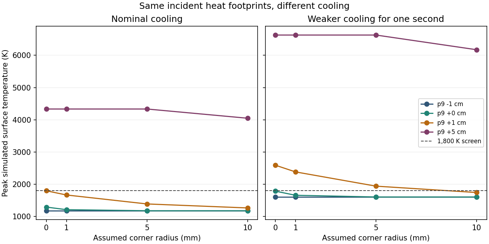

# OPENSTEP-009 · When a cooling fault changes the heat-load decision

[Explore the temperature histories](https://enuminous.github.io/Tokamak/#target-cooling) · [Read the popular science essay](https://enuminous.github.io/papers/Where-Does-the-Heat-Go-2026-11-24.html).

The four archived coil configurations crossed with four target-corner radii give 16 imposed heat footprints. Under a two-second heat pulse, 4 of 16 exceed the assumed 1,800 K surface-temperature screen. Degrading backside heat transfer for the second second raises the count to 7 of 16. These are counts over declared geometries. They have no frequency or probability interpretation.

| 257 × 513 source, sharp corner | Peak heat input, MW/m² | Nominal peak, K | Degraded peak, K |
|---|---:|---:|---:|
| p9 -1 cm | 11.84 | 1,173.6 | 1,601.7 |
| p9 +0 cm | 13.69 | 1,287.1 | 1,782.3 |
| p9 +1 cm | 21.97 | 1,793.1 | 2,587.7 |
| p9 +5 cm | 63.52 | 4,332.9 | 6,630.2 |



All three additional crossings occur at **+1 cm**, with sharp, 1 mm and 5 mm radii. The 10 mm case stays under the screen in this fixture. All +5 cm cases cross in both cooling schedules. The baseline sharp geometry reaches about 1,782 K with degraded cooling, only 18 K below the screen. No uncertainty interval supports a real operating margin of 18 K. Extrapolated temperatures above material service limits indicate a broken model assumption; this calculation has no phase-change or damage model.

The face is heated uniformly through its local maximum flux. One-dimensional conduction moves energy through a 5 mm slab to a heat-transfer boundary. Each configuration uses the same material and pulse. Abruptly removing the imposed heat changes the algebraic surface reconstruction at finite cell size. Records retain one-sided samples. The incoming heat comes from the optimized maximum over the launch window in OPENSTEP-005. That is a different observable from the 1 mm representative heat in OPENSTEP-003.

**Checks.** 107/107 registered controls, conservation, coverage and refinement checks passed. The largest 32-to-64-cell change in peak was 0.012 K; worst normalized energy discrepancy was 8.15 × 10⁻¹³ or less. A separately assembled, direct backward-Euler heat balance agreed with the modal method on both loaded-face samples (2 s and 5 s) in all 32 cases, within 2.13 K under the 3 K criterion. Both implementations share the same input flux and constitutive assumptions. The comparison bounds implementation disagreement at the tested points.

[Primary protocol](PROTOCOL.md) · [Independent-discretization extension](CROSSCHECK.md) · [32 cases](results/cases.csv) · [sampled temperature histories](results/histories.csv) · [all primary checks](results/assessment.json) · [second method](results/crosscheck.json).

```sh
OPENBLAS_NUM_THREADS=1 python benchmarks/openstep-009/thermal.py /tmp/openstep009
OPENBLAS_NUM_THREADS=1 python benchmarks/openstep-009/crosscheck.py /tmp/openstep009
```

**What would test the result physically?** Supply registered target CAD and a measured incident heat-flux history. In an instrumented coupon test, compare calibrated front-face thermography, backside temperature, flow and coolant calorimetry on the same clock, with independent estimates of conductivity, material heat capacity, contact resistance and film heat transfer. Freeze the predicted temperature band and crossing-time tolerance before opening the measured trace. The temperature screen and illustrative film reduction here are computational fixtures.

The browser uses a static copy of the two CSVs for offline viewing. Run `python benchmarks/openstep-009/export_browser.py --check` to compare it byte-for-byte against a fresh export. Peak and first-crossing values use the original 0.01 s sampling; the plotted histories use the 0.1 s export and retain both sides of interval boundaries.
